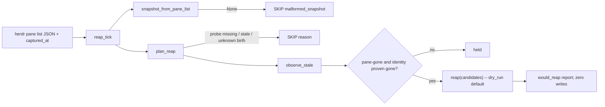

# Owner-lease reap wiring

Status: design plus dry-run-only code. Nothing here touches the live lease store.
It reads no live pane state, sets no `HERDR_` flag and changes no runtime caller.
REAP apply stays OFF, as Terrence set it.

Code: `lib/owner_lease_reap.py`. Offline proof: `verify-owner-lease-reap-wiring.py`,
which runs in `.github/workflows/owner-lease.yml`.

## Answers

| Question | Answer |
|---|---|
| Who calls `observe_stale` / `reap`? | Only `owner_lease_reap.reap_tick()`. It calls `observe_stale` through `plan_reap()`, then calls `reap()`. Never `acquire()`, `claim_initial()` or `claim_successor()`. |
| When? | Today, nothing calls `reap_tick` automatically. Phase 2 adds a hub tick behind `HERDR_OWNER_LEASE_REAP=1`, still dry-run. Phase 3 (apply) is a separate, approved change. |
| Probe source | `herdr pane list` JSON (`(.result.panes // .panes)`), plus a `captured_at` that the caller records. |
| Dry run | Structural: no parameter reaches `reap(dry_run=False)`. The phase-2 caller opens the store read-only. |
| Fail closed | Whole-tick SKIP when the probe is missing, stale, of unknown age, unparseable, or has any unknown birth. Per-lease HOLD when a holder's identity can't be proven gone. |
| Does `acquire` refuse a dead caller? | No. See "acquire and a dead caller". |
| How does REAP_APPLY stay off? | No apply code path exists, no `*_REAP_APPLY` variable is read anywhere, and the store is opened read-only. |
| Rollback | Unset the flag and restart the hub. The registry has `disable()`, and `export_backup()` gives a restore point. See "Rollback". |

## Why a guard layer

`observe_stale(conn, live_panes)` (`lib/owner_lease.py:544-555`) marks a lease
`pane-gone` whenever the exact `(pane_id, pane_birth)` pair is missing from
`live_panes`. It trusts that set completely. Two real inputs would make it
release a live holder:

1. **Unknown birth.** If a controller drops a pane record with an empty or
   malformed `terminal_id`, the live holder is missing from the set. Reproduced in
   `tmp/c1/reap-guard-PROOF.md` "#negative-proof". Fixed by the r3 guard
   (`plan_reap` skips the whole tick, `unknown_birth`).
2. **herdr restart.** A herdr server restart reissues `terminal_id` for every
   pane it re-enumerates, even though the agent process never died
   (`lib/run-registry.sh:229-238`; `lib/reconcile.sh:142-233` corroborates this
   with `agent_session`). The holder's pane id is still present, but under a new
   birth, so the exact pair is absent. Reproduced before this change:
   `tmp/c1/birth-reissue-repro.py` printed
   `status=ok candidates=['w1:p1']`, `HAZARD: live holder would be reaped`.

Fix for (2), in `plan_reap`: a `pane-gone` observation whose pane id is still in
the snapshot becomes a candidate only when the live record's
`agent_session.value` is present **and** `sha256("<label>:<agent_session>")`
differs from the lease's `session_digest`. That means the pane id was recycled to
a different agent. The digest is derived the same way as
`remote-mcp/publisher.owner_session_digest`, and a parity case in the verifier
pins that. Outcomes:

| Pane id in snapshot? | Live session vs lease digest | Result |
|---|---|---|
| no | – | candidate (`pane-gone`) |
| yes, new birth | same | held `birth_reissued` (alive; herdr restarted) |
| yes, new birth | different | candidate (pane recycled) |
| yes, new birth | either side missing | held `identity_uncertain` |

A pane id that is absent is still a candidate. Nothing in this repo documents
herdr renumbering pane ids, and reconcile.sh treats an absent id as gone too.

## Who calls it, and when

- **Phase 1 (this change):** `reap_tick` exists, but nothing calls it
  automatically. Its callers are the offline verifier and
  `tmp/c1/reap-tick-smoke.py`, which runs on fixture pane lists.
- **Phase 2 (dry-run in the hub, needs approval to flip):** a hub controller,
  added as a sibling of `_queue_tick` (`hub.py:1936`) on the attention cadence.
  It runs only when `HERDR_OWNER_LEASE_REAP` is exactly `"1"`. Every 60 s at most,
  it opens the lease DB read-only, calls `reap_tick`, and logs a structured line
  (counts, labels, generations, reasons). It writes no `owner_events`. Exceptions
  are caught and logged, and the attention loop keeps running. Probe input is
  covered below.
- **Phase 3 (apply):** see "Turning REAP_APPLY on".

**Not a caller:** `acquire()`, `claim_initial()` and `claim_successor()`. Each is
a single `BEGIN IMMEDIATE` SQLite transaction (`lib/owner_lease.py:239-251`).
Probing herdr inside one would hold the store's write lock across an external
RPC. It would also let probe freshness decide whether a claim succeeds.

## Probe

The input is `herdr pane list` output, parsed by `snapshot_from_pane_list`
with the same `(.result.panes // .panes)` selector that `lib/pane-guard.sh:89-91`
and `lib/reconcile.sh:105-117` use. Fields read: `pane_id`, `terminal_id` (the
birth) and `agent_session.value`.

herdr's payload carries no timestamp, so the caller passes `captured_at`, the
epoch seconds at which the output was read. Age is `now - captured_at`, and it
must be in `[0, 30]` s (`DEFAULT_MAX_SNAPSHOT_AGE_S`).

Phase-2 source: `hub.py:497-504` documents why the hub stopped shelling out to
`herdr pane list` (it would be a second, disagreeing model of pane state). So the
phase-2 controller must not add a new poll. It should feed `reap_tick` the
`panes` array from the subscription's own `session.snapshot` resync
(`lib/herdr_live.py:695-699`), along with that resync's wall-clock time.
Prerequisites before phase 2:

- `LiveState` exposes the last authoritative snapshot's `panes` (identity fields
  only) and its capture time. Today the projection drops `agent_session`
  (`lib/herdr_live.py:181-192`) and records no snapshot time.
- [INFERENCE, unverified] `session.snapshot` panes carry `agent_session.value` in
  the same shape as `pane list`. `_pane_record` reads `terminal_id` from them,
  but nothing here reads `agent_session` from a snapshot. Without
  `agent_session`, every reissued birth is held `identity_uncertain`. That is
  safe, but it would make the dry run under-report.

## Fail-closed rules

| Condition | Result |
|---|---|
| payload `None` (probe did not run or failed) | SKIP `probe_unavailable` |
| invalid JSON; no `panes` array; non-object entry; pane id not `w…:p…`; duplicate pane id | SKIP `malformed_snapshot` |
| any birth empty, missing or malformed (fullmatch `term_[0-9a-z]{1,40}`) | SKIP `unknown_birth` |
| `captured_at` missing, non-numeric, or a bool; age negative, non-finite or > 30 s | SKIP `stale_snapshot` |
| holder's pane id present under a new birth, identity not proven different | lease held (`birth_reissued` / `identity_uncertain`) |
| SQLite error | exception: the tick fails, nothing is applied |

A SKIP never shrinks the live set and never yields a candidate. A connected,
genuinely empty pane list (`{"result":{"panes":[]}}`) is valid, so every holder
becomes a candidate. That is acceptable for a dry run. Apply needs the
two-snapshot rule below.

Expired leases are never candidates. The clock path (`claim_successor`) owns
them. A `reaped:expired` release reason would break the standing-grant restart
rule, which checks for exactly `release_reason == "expired"`
(`lib/owner_dispatch_auth.py:307-321`).

## acquire and a dead caller

Decision: **`acquire()` / `claim_*()` do not probe liveness and do not refuse a
"dead" caller.**

- A dead pane runs no code, so it can't call anything. The real case is a
  caller that presents a stale `(pane, birth, session)` tuple. In production,
  that tuple is never caller-chosen. `owner-dispatch-issue.py:775-781` and
  `owner-lease-claim.py:61` take it from the registry resolver, and
  `owner-dispatch-issue.py:408` revalidates it before issuing.
- `acquire()` has no production caller. In this repo it appears only in `verify-*`
  fixtures.
- If a stale tuple ever does win a claim, the next reap tick reports it as
  `pane-gone`. That is the same path as any other dead holder, so a second
  liveness model isn't needed.
- Cost of the alternative: an external RPC inside the IMMEDIATE transaction (see
  above). A pre-claim liveness check in `owner-dispatch-issue.py` would also be a
  new control for a failure nobody has observed, so it is not proposed here.

## After a reap (phase 3 only)

- `reap()` releases by CAS on the full observed identity
  (`lib/owner_lease.py:561-592`). It writes `release_reason='reaped:pane-gone'`
  plus one `reaped` event, and a holder that renewed since the observation keeps
  its lease (`reap-skipped`).
- A replacement goes through `claim_successor()`, which is approval-bound. It
  still refuses while any request is open (`lib/owner_lease.py:445-448`), so
  reaping never silently stales queued work. A reaped holder is not eligible for
  the standing-grant restart rule, by design.
- A falsely reaped holder **cannot re-claim as itself**. `claim_successor`
  refuses `same_holder` (`lib/owner_lease.py:449-450`) and `claim_initial`
  refuses any history (`:377-378`). A false reap is therefore not cheaply
  reversible, which is why the bar for apply is high.

## How REAP_APPLY stays off

1. **No code path.** `reap_tick` calls `ol.reap(conn, candidates, now=now)` and
   relies on its `dry_run=True` default. There is no parameter, flag or env read
   that changes this. `grep -n "dry_run=False" lib/owner_lease_reap.py` returns
   nothing.
2. **No variable.** No `HERDR_OWNER_LEASE_REAP_APPLY` (or any `*REAP_APPLY*`)
   is read anywhere in the repo. Setting one in an environment does nothing.
3. **Read-only store.** The phase-2 controller opens the lease DB as
   `file:…?mode=ro`. `reap_tick` works on a read-only connection (verifier case
   `dry_run_tick_runs_on_read_only_connection_and_writes_nothing`). The smoke run
   shows that an apply attempt on such a connection fails:
   `attempt to write a readonly database`.

## Turning REAP_APPLY on (requirements, none met yet)

1. Terrence decides first-hand, through a decision form. Nobody else can turn
   it on.
2. Phase 2 has run dry in the hub, and its log has been reviewed. It must show
   zero false candidates, including across at least one herdr server restart.
3. A separate PR adds the apply path: `HERDR_OWNER_LEASE_REAP_APPLY` exactly
   `"1"`, AND `HERDR_OWNER_LEASE_REAP=1`, read by the hub only. In that mode only,
   the store is opened read/write through `lib/private_sqlite.open_private`. The
   PR also adds:
   - **Two fresh snapshots:** a candidate is applied only when it is observed in
     two consecutive fresh ticks with the same CAS identity. This matches
     `lib/reconcile.sh:119-123`, which confirms a missing pane once before burying
     its task, because pane publication races spawns.
   - **Mass-event brake:** if 2 or more labels become candidates in one tick,
     apply nothing for that tick and log it. This matches reconcile.sh's
     `uncertain_count >= 2` shared-cause rule.
   - An `export_backup()` 0600 copy taken before the first apply.
4. That PR gets a frozen-diff security review with zero open high/critical
   findings, and a red test proving the brake and the two-snapshot rule fire on
   real negatives.

## Rollback

1. **Dry-run controller (phase 2):** unset `HERDR_OWNER_LEASE_REAP` and restart
   the hub. It wrote nothing, so there is nothing to undo.
2. **Apply (phase 3):** unset `HERDR_OWNER_LEASE_REAP_APPLY` first, restart, and
   confirm the next tick logs `dry_run: true`.
3. **Registry emergency:** `owner_lease.disable(conn)` makes every mutation
   fail closed while readers keep working (`lib/owner_lease.py:595-605`). The
   dry-run tick still reports on a disabled registry (verifier case
   `disabled_registry_still_observes_dry_run`).
4. **Wrong reap:** reaped rows are audit history and are never edited in place.
   Restore by opening the pre-activation `export_backup()` copy
   (`lib/owner_lease.py:608-618`), as the existing restore-on-copy contract
   describes, or by having an operator approve a successor claim for a different
   session.
5. **Code:** reverting this branch's commits removes `lib/owner_lease_reap.py`.
   Nothing imports it at runtime.

## Lineage and unverified items

- The `plan_reap` guard was cherry-picked from local branch
  `implement/owner-lease-reap-guard-r3` (`c679513`, `a6aa6a6`, `831eb4b`),
  which reviewers had approved through r3. **PR state UNVERIFIED** (this worker
  has no `gh`/network access). If that branch merges first, rebasing this one
  drops the duplicate patches.
- The phase-2 subscription `agent_session` shape is unverified (see "Probe").
