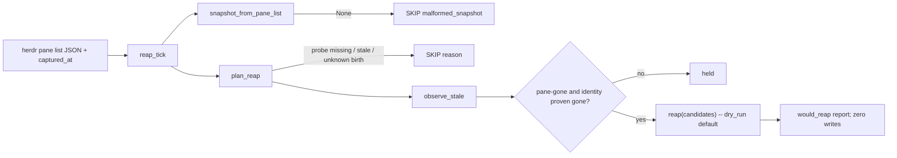

# Owner-lease reap wiring

Status: phase 1 (`lib/owner_lease_reap.py`) plus phase 2 wiring (S4(c):
`owner-lease-reap.py`, `hub.py` `_reap_tick()`). Both OFF by default.
Nothing here touches the live lease store: the phase-2 CLI opens it
READ-ONLY, sets no `HERDR_OWNER_LEASE_REAP` flag itself (the hub's
environment must already carry it), and changes no other runtime caller.
REAP apply stays OFF, as Terrence set it, with no code path to turn it on.

Code: `lib/owner_lease_reap.py`, `owner-lease-reap.py`, `hub.py` `_reap_tick()`
(sibling of `_queue_tick`, `hub.py:1937`, at `hub.py:1967`). Offline proof:
`verify-owner-lease-reap-wiring.py` and `verify-owner-lease-reap-cli.py`,
both run in `.github/workflows/owner-lease.yml`.

## Answers

| Question | Answer |
|---|---|
| Who calls `observe_stale` / `reap`? | Only `owner_lease_reap.reap_tick()`. It calls `observe_stale` through `plan_reap()`, then calls `reap()`. Never `acquire()`, `claim_initial()` or `claim_successor()`. |
| When? | `owner-lease-reap.py` is a one-shot CLI; `hub.py` `_reap_tick()` spawns it at most once per 60s, and only when `HERDR_OWNER_LEASE_REAP=1` is in the hub's own environment (unset today). Phase 3 (apply) is a separate, approved change. |
| Probe source | `herdr pane list`, one subprocess per CLI run (5s timeout), captured by the CLI itself -- not the hub's live pane subscription. See "Probe". |
| Dry run | Structural: no parameter, flag or env read anywhere in this change reaches `reap(dry_run=False)`. The CLI opens the store read-only (`mode=ro`). |
| Fail closed | Whole-tick SKIP when the probe is missing, stale, of unknown age, unparseable, or has any unknown birth. Per-lease HOLD when a holder's identity can't be proven gone, OR when it was claimed at/after the snapshot was captured (`claimed_after_snapshot`; see "Probe"). |
| Does `acquire` refuse a dead caller? | No. See "acquire and a dead caller". |
| How does REAP_APPLY stay off? | No apply code path exists, no `*_REAP_APPLY` variable is read anywhere, and the store is opened read-only. |
| Rollback | Unset `HERDR_OWNER_LEASE_REAP` and restart the hub. Nothing was written, so there is nothing to undo. The registry has `disable()`, and `export_backup()` gives a restore point. See "Rollback". |

## Why a guard layer

`observe_stale(conn, live_panes)` (`lib/owner_lease.py:544-555`) marks a lease
`pane-gone` whenever the exact `(pane_id, pane_birth)` pair is missing from
`live_panes`. It trusts that set completely. Two real inputs would make it
release a live holder:

1. **Unknown birth.** If a controller drops a pane record with an empty or
   malformed `terminal_id`, the live holder is missing from the set. Reproduced in
   `tmp/c1/reap-guard-PROOF.md` "#negative-proof". Fixed by the r3 guard
   (`plan_reap` skips the whole tick, `unknown_birth`).
2. **herdr restart.** A herdr server restart reissues `terminal_id` for every
   pane it re-enumerates, even though the agent process never died
   (`lib/run-registry.sh:229-238`; `lib/reconcile.sh:142-233` corroborates this
   with `agent_session`). The holder's pane id is still present, but under a new
   birth, so the exact pair is absent. Reproduced before this change:
   `tmp/c1/birth-reissue-repro.py` printed
   `status=ok candidates=['w1:p1']`, `HAZARD: live holder would be reaped`.

Fix for (2), in `plan_reap`: a `pane-gone` observation whose pane id is still in
the snapshot becomes a candidate only when the live record's
`agent_session.value` is present **and** `sha256("<label>:<agent_session>")`
differs from the lease's `session_digest`. That means the pane id was recycled to
a different agent. The digest is derived the same way as
`remote-mcp/publisher.owner_session_digest`, and a parity case in the verifier
pins that. Outcomes:

| Pane id in snapshot? | Live session vs lease digest | Result |
|---|---|---|
| no | – | candidate (`pane-gone`) |
| yes, new birth | same | held `birth_reissued` (alive; herdr restarted) |
| yes, new birth | different | candidate (pane recycled) |
| yes, new birth | either side missing | held `identity_uncertain` |

A pane id that is absent is still a candidate. Nothing in this repo documents
herdr renumbering pane ids, and reconcile.sh treats an absent id as gone too.

## Who calls it, and when

- **Phase 1:** `reap_tick` exists, but nothing calls it automatically. Its
  callers are the offline verifier and `tmp/c1/reap-tick-smoke.py`, which
  runs on fixture pane lists.
- **Phase 2 (S4(c), wired and OFF by default):** `owner-lease-reap.py` is a
  one-shot CLI. `hub.py` `_reap_tick()`, a sibling of `_queue_tick`
  (`hub.py:1937`, itself at `hub.py:1967`), runs it on the attention
  cadence through the same non-blocking `TickRunner` the queue tick uses
  (`lib/queue_supervisor.py:353-419`). It runs only when
  `HERDR_OWNER_LEASE_REAP` is exactly `"1"` in the hub's own environment
  (unset today). At most once per 60 s, the CLI reads `herdr pane list`,
  opens the lease DB read-only, calls `reap_tick`, and appends a structured
  JSON line to its own report log (counts, labels, generations, reasons).
  It writes no `owner_events`. Exceptions inside the hub's poll are caught
  and logged (`reap tick error: ...`), and the attention loop keeps
  running. Probe input is covered below.
- **Phase 3 (apply):** see "Turning REAP_APPLY on".

**Not a caller:** `acquire()`, `claim_initial()` and `claim_successor()`. Each is
a single `BEGIN IMMEDIATE` SQLite transaction (`lib/owner_lease.py:239-251`).
Probing herdr inside one would hold the store's write lock across an external
RPC. It would also let probe freshness decide whether a claim succeeds.

## Probe

The input is `herdr pane list` output, parsed by `snapshot_from_pane_list`
with the same `(.result.panes // .panes)` selector that `lib/pane-guard.sh:89-91`
and `lib/reconcile.sh:105-117` use. Fields read: `pane_id`, `terminal_id` (the
birth) and `agent_session.value`.

herdr's payload carries no timestamp, so the caller passes `captured_at`, the
epoch seconds at which the output was read. Age is `now - captured_at`, and it
must be in `[0, 30]` s (`DEFAULT_MAX_SNAPSHOT_AGE_S`).

**Probe source: a dedicated `herdr pane list` subprocess, one per CLI run, NOT
the hub's live pane subscription.** `hub.py:497-504`'s objection is to a
per-read shell-out behind a 3 s cache inside the hub itself -- 84 RPCs per
60 s of a reader waiting, which the push-based control plane removed. This
design's CLI runs one RPC per 60 s in its own child process, the same cadence
`lib/reconcile.sh:105,125` and `lib/pane-guard.sh:87,301` already use per
sweep/action. The live subscription's own `LiveState` projection drops
`agent_session` (`lib/herdr_live.py:181-192`) and records no snapshot time,
so feeding it to `reap_tick` would hold every reissued birth
`identity_uncertain` -- safe, but an under-report -- and would need
`LiveState` code changes first. `owner-lease-reap.py` records
`captured_at = time.time()` **before** the subprocess call, so the clock
read can only make the snapshot look OLDER than it is, never younger; a
process read before the call cannot be skewed by the RPC's own latency.

**Claimed-after-snapshot hold.** A pane that spawns and claims AFTER
`captured_at` can still be absent from that same snapshot even though it is
alive -- the spawn/register race `lib/reconcile.sh:119-122` already guards
against. `plan_reap(..., snapshot_at=captured_at)` holds any `pane-gone`
observation whose `acquired_at >= _iso(snapshot_at)` as
`claimed_after_snapshot`, string-compared on `_iso()`'s fixed-width,
always-UTC, microsecond format (`lib/owner_lease.py:130-131`) so the
comparison needs no parsing. A renewal does not need the same check: a
renewal must present the exact live `(pane, birth, session)`
(`lib/owner_lease.py:349`), and a birth is never reused
(`lib/pane-guard.sh:79-80`), so a holder whose `(pane, birth)` is absent
from a pre-renewal snapshot was already absent at renewal time.
`snapshot_at=None` (a direct `plan_reap` caller with no capture time) holds
EVERY `pane-gone` observation this way -- fail-safe for unknown freshness.
`reap_tick` always passes a real `captured_at` once it has already passed
its own `stale_snapshot` freshness check, so this arm never fires on the
hub's path.

## Fail-closed rules

| Condition | Result |
|---|---|
| payload `None` (probe did not run or failed) | SKIP `probe_unavailable` |
| invalid JSON; no `panes` array; non-object entry; pane id not `w…:p…`; duplicate pane id | SKIP `malformed_snapshot` |
| any birth empty, missing or malformed (fullmatch `term_[0-9a-z]{1,40}`) | SKIP `unknown_birth` |
| `captured_at` missing, non-numeric, or a bool; age negative, non-finite or > 30 s | SKIP `stale_snapshot` |
| holder's pane id present under a new birth, identity not proven different | lease held (`birth_reissued` / `identity_uncertain`) |
| lease `acquired_at` >= the snapshot's `captured_at` (or `captured_at` unknown) | lease held `claimed_after_snapshot` |
| SQLite error | exception: the tick fails, nothing is applied |

A SKIP never shrinks the live set and never yields a candidate. A connected,
genuinely empty pane list (`{"result":{"panes":[]}}`) is valid, so every holder
becomes a candidate. That is acceptable for a dry run. Apply needs the
two-snapshot rule below.

Expired leases are never candidates. The clock path (`claim_successor`) owns
them. A `reaped:expired` release reason would break the standing-grant restart
rule, which checks for exactly `release_reason == "expired"`
(`lib/owner_dispatch_auth.py:307-321`).

## acquire and a dead caller

Decision: **`acquire()` / `claim_*()` do not probe liveness and do not refuse a
"dead" caller.**

- A dead pane runs no code, so it can't call anything. The real case is a
  caller that presents a stale `(pane, birth, session)` tuple. In production,
  that tuple is never caller-chosen. `owner-dispatch-issue.py:775-781` and
  `owner-lease-claim.py:61` take it from the registry resolver, and
  `owner-dispatch-issue.py:408` revalidates it before issuing.
- `acquire()` has no production caller. In this repo it appears only in `verify-*`
  fixtures.
- If a stale tuple ever does win a claim, the next reap tick reports it as
  `pane-gone`. That is the same path as any other dead holder, so a second
  liveness model isn't needed.
- Cost of the alternative: an external RPC inside the IMMEDIATE transaction (see
  above). A pre-claim liveness check in `owner-dispatch-issue.py` would also be a
  new control for a failure nobody has observed, so it is not proposed here.

## S1 preflight must read S3 precondition (b); no path disposes of open requests

Reap wiring is orthogonal to S3 (the stale `kb-gitstatus-003` lease,
`ol_dbd380b4...`): `observe_stale` reports it `expired` before it can ever be
`pane-gone` (`lib/owner_lease.py:551`), so reap never touches it in dry-run OR
apply mode. S3's own path is `claim_successor()`, which requires `_live()`
false (released or expired) AND **zero open `owner_requests` for the label**
AND a different new holder (`lib/owner_lease.py:430-432, 445-448, 449-450`).

The runbook's S1 preflight (`/tmp/factory-p1-preflight.sh`, read-only) must
read precondition (b) -- zero open `owner_requests` for the label -- BEFORE
any `build-form`/`claim_successor` attempt, not discover it as a mid-transaction
refusal. `build_main` (`owner-dispatch-issue.py:535-593`, "build-form") reads
the predecessor tuple from `--lease-db` but does not itself query
`owner_requests`; today the check only happens inside `claim_successor`'s own
transaction, at issue time.

**Gap, not invented a path for:** if precondition (b) fails (open requests
exist on the expired, dead-holder lease), there is **no production code path**
that disposes of them. `_fence` (`lib/owner_lease.py:469-472`) refuses because
the holder isn't live, so `transition()` can't clear them either; `acquire()`'s
staling branch has no production caller; reap does not touch requests at all
(`lib/owner_lease.py:561-592` only ever releases lease rows). `claim_successor`
then refuses `open_requests` (`owner-dispatch-issue.py:784-785`), and S3 stops
and goes to T. This change does not add one: inventing a disposal path here
would be new, unreviewed control-plane surface for a gap the design only needs
to detect, not resolve.

## After a reap (phase 3 only)

- `reap()` releases by CAS on the full observed identity
  (`lib/owner_lease.py:561-592`). It writes `release_reason='reaped:pane-gone'`
  plus one `reaped` event, and a holder that renewed since the observation keeps
  its lease (`reap-skipped`).
- A replacement goes through `claim_successor()`, which is approval-bound. It
  still refuses while any request is open (`lib/owner_lease.py:445-448`), so
  reaping never silently stales queued work. A reaped holder is not eligible for
  the standing-grant restart rule, by design.
- A falsely reaped holder **cannot re-claim as itself**. `claim_successor`
  refuses `same_holder` (`lib/owner_lease.py:449-450`) and `claim_initial`
  refuses any history (`:377-378`). A false reap is therefore not cheaply
  reversible, which is why the bar for apply is high.

## How REAP_APPLY stays off

1. **No code path.** `reap_tick` calls `ol.reap(conn, candidates, now=now)` and
   relies on its `dry_run=True` default. There is no parameter, flag or env read
   that changes this. `grep -n "dry_run=False" lib/owner_lease_reap.py` returns
   nothing.
2. **No variable.** No `HERDR_OWNER_LEASE_REAP_APPLY` (or any `*REAP_APPLY*`)
   is read anywhere in the repo. Setting one in an environment does nothing.
3. **Read-only store.** The phase-2 controller opens the lease DB as
   `file:…?mode=ro`. `reap_tick` works on a read-only connection (verifier case
   `dry_run_tick_runs_on_read_only_connection_and_writes_nothing`). The smoke run
   shows that an apply attempt on such a connection fails:
   `attempt to write a readonly database`.

## Turning REAP_APPLY on (requirements, none met yet)

1. Terrence decides first-hand, through a decision form. Nobody else can turn
   it on.
2. Phase 2 has run dry in the hub, and its log has been reviewed. It must show
   zero false candidates, including across at least one herdr server restart.
3. A separate PR adds the apply path: `HERDR_OWNER_LEASE_REAP_APPLY` exactly
   `"1"`, AND `HERDR_OWNER_LEASE_REAP=1`, read by the hub only. In that mode only,
   the store is opened read/write through `lib/private_sqlite.open_private`. The
   PR also adds:
   - **Two fresh snapshots:** a candidate is applied only when it is observed in
     two consecutive fresh ticks with the same CAS identity. This matches
     `lib/reconcile.sh:119-123`, which confirms a missing pane once before burying
     its task, because pane publication races spawns.
   - **Mass-event brake:** if 2 or more labels become candidates in one tick,
     apply nothing for that tick and log it. This matches reconcile.sh's
     `uncertain_count >= 2` shared-cause rule.
   - An `export_backup()` 0600 copy taken before the first apply.
4. That PR gets a frozen-diff security review with zero open high/critical
   findings, and a red test proving the brake and the two-snapshot rule fire on
   real negatives.

## Rollback

1. **Dry-run controller (phase 2):** unset `HERDR_OWNER_LEASE_REAP` and restart
   the hub. It wrote nothing, so there is nothing to undo.
2. **Apply (phase 3):** unset `HERDR_OWNER_LEASE_REAP_APPLY` first, restart, and
   confirm the next tick logs `dry_run: true`.
3. **Registry emergency:** `owner_lease.disable(conn)` makes every mutation
   fail closed while readers keep working (`lib/owner_lease.py:595-605`). The
   dry-run tick still reports on a disabled registry (verifier case
   `disabled_registry_still_observes_dry_run`).
4. **Wrong reap:** reaped rows are audit history and are never edited in place.
   Restore by opening the pre-activation `export_backup()` copy
   (`lib/owner_lease.py:608-618`), as the existing restore-on-copy contract
   describes, or by having an operator approve a successor claim for a different
   session.
5. **Code:** reverting this branch's commits removes `lib/owner_lease_reap.py`.
   Nothing else (`owner-lease-reap.py`, `hub.py` `_reap_tick()`) imports it or
   runs unless `HERDR_OWNER_LEASE_REAP=1` is also set in the hub's environment.

## Lineage and unverified items

- The `plan_reap` guard was cherry-picked from local branch
  `implement/owner-lease-reap-guard-r3` (`c679513`, `a6aa6a6`, `831eb4b`),
  which reviewers had approved through r3. **PR state UNVERIFIED** (this worker
  has no `gh`/network access). If that branch merges first, rebasing this one
  drops the duplicate patches.
- S4(c) (DESIGN-reap.md, ACCEPT-WITH-NOTES review) replaced the prior doc's
  LiveState-subscription probe plan with a dedicated `herdr pane list`
  subprocess per CLI run (see "Probe"); the subscription's unverified
  `agent_session` shape is no longer load-bearing for phase 2.
