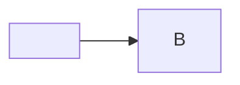

```text
# a fenced comment, not the title
## Captain calls (fenced: not a section)
```

# Feed fix: <b>debt</b> & calls

Read-only scout.  stays text. See [the register](#debt-register), [the PR](https://github.com/example/demo-repo/pull/41), [a trap](javascript:alert(1)) and https://github.com/example/demo-repo/issues/7.

## Debt register

| ID | Repo | Item | Sev |
|---|---|---|---|
| D-001 | demo-repo | **No backup** of `data/` | P1 |
| D-002 | demo-repo, other-repo | pipe in code: `a \| b` | P2 |
| D-003 | other-repo | stale deps <script>alert("cell")</script> | P3 |
| D-004 | demo-repo | flaky test | P2 |



## Captain calls

1. **Backfill?**
   - (a) yes. **Recommended.**
   - (b) no.
2. **Retire the old feed.** Recommended: retire.

## Appendix

Nothing else.
