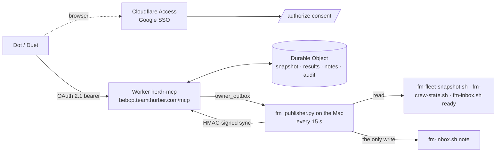
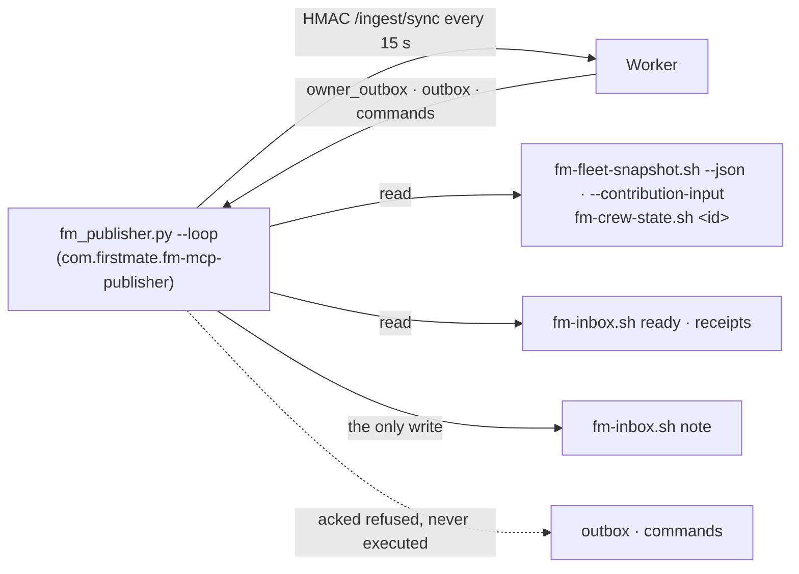
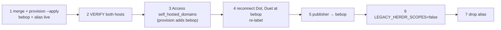

# Bebop — Firstmate's authenticated remote MCP

A remote MCP server at **`https://bebop.teamthurber.com/mcp`** that lets two
named apps, **Dot** (ChatGPT) and **Duet** (Claude.ai), read the Firstmate
fleet (tasks, typed PR links, open captain decisions with their options and
recommendation, scout/ship reports, Firstmate's posture) and leave Firstmate
**notes**: a message, a task request, a note about an open decision, or an
app-to-app peer note. Nothing a remote app sends is ever auto-actioned or
treated as the captain's word.

It is not a remote desktop. There is no tool that runs a command, presses a
key, starts or cancels a task, answers an approval prompt, releases a hold,
or reaches the loopback hub.

Bebop is the herdr-mcp Worker renamed and narrowed (Phase 2). The Worker
script keeps its `herdr-mcp` name, so the Durable Object, the OAuth KV and
every grant carry over. `herdr-mcp.teamthurber.com` is still served as an
**alias** during the cutover (see "Bebop cutover runbook").



The Mac only makes outbound HTTPS calls. Nothing new listens on it, and the hub
stays loopback-only.

## Authentication

| Surface | Mechanism |
|---|---|
| App → `/mcp` | OAuth 2.1 authorization code + PKCE (S256) bearer token, audience-bound to `<origin>/mcp` (RFC 8707 `resource`). Clients identify by CIMD (their client ID metadata document URL); only the two in `CLIENT_GRANTS` hold anything. RFC 9207 `iss` in every authorization response. Discovery: `/.well-known/oauth-protected-resource/mcp` (RFC 9728), `/.well-known/oauth-authorization-server` (RFC 8414). Access token 1 h; refresh 30 days, idles out after 7. |
| Human consent → `/authorize` | Path-scoped Cloudflare Access app `herdr-mcp-authorize` covering `<host>/authorize` for every served host (Google Workspace IdP pinned, policy = `ALLOWED_EMAILS`). The Worker **also** verifies the `Cf-Access-Jwt-Assertion` (RS256 against the team JWKS, issuer- and AUD-pinned, email allowlisted), so a removed or widened Access app fails closed. Consent is CSRF-bound to the browser by the provider's `__Host-` cookie + handle, and refuses any client outside `CLIENT_GRANTS` before the page renders. |
| Mac → `/ingest/sync` | HMAC-SHA256 over `ts.nonce.sha256(body)` with `INGEST_KEY`; ±300 s skew; nonces single-use. Never an OAuth token. |

**Hosts.** `PUBLIC_URL` (bebop) is canonical; each origin in `ALIAS_URLS`
(herdr-mcp, during the cutover) is a full second OAuth front door with its own
issuer, resource and metadata — the provider is built per origin. A token
issued with a resource is audience-bound to that origin, so it never works on
the other host; a stored token with no audience resolves to whichever host it
is presented at, which grants nothing extra (effective scopes do not depend on
the host). Any other `Host` gets `421 Misdirected Request`.
`/healthz` reports `host_role` (`canonical`/`alias`) and `canonical_mcp`.

### Scopes (`fm:*`), least privilege

| Scope | Tools | Writes |
|---|---|---|
| `fm:read` | `get_status`, `get_posture`, `list_agents`, `list_tasks`, `get_task`, `list_blockers`, `list_decisions`, `get_decision`, `list_events`, `wait_for_events`, consumer positions | none |
| `fm:reports` | `get_task_result`, `list_reports`, `get_report` | none |
| `fm:request` | `send_owner_message`, `request_task`, plus status/reply of its own notes | a note in Firstmate's inbox |
| `fm:decide-note` | `answer_decision`, plus status/reply of its own notes | a note in Firstmate's inbox, tied to an OPEN decision |
| `fm:peer` | `send_peer_message`, `list_peer_messages` | a note held on the server for the other app |

`fm:request`, `fm:decide-note` and `fm:peer` exist only while
`OWNER_INBOX_ENABLED` is `"true"`: off, the consent page does not offer them,
the AS metadata does not advertise them, their tools are not listed, and the
Durable Object refuses them even on a token granted while it was on. Every
note travels the owner inbox, which also has its Mac switch
(`fm_publisher.py` delivers only to the registered `firstmate` owner).

**Effective scopes** (`policy.ts` `effectiveScopes`) = what the token was
granted ∩ what this deployment offers ∩ the client's ceiling. Computed on
every request, so a grant can never outgrow its client. A tool is registered
only when one of its scopes is effective, and the gate re-checks before it
runs.

### Per-client grants (default deny)

| Client | CIMD client_id | Ceiling |
|---|---|---|
| **dot** (ChatGPT) | `https://chatgpt.com/oauth/client.json` | `fm:read fm:reports fm:request fm:decide-note fm:peer` |
| **duet** (Claude.ai) | `https://claude.ai/oauth/mcp-oauth-client-metadata` | `fm:read fm:reports fm:request fm:decide-note fm:peer` |
| anything else (any DCR registration, any other CIMD URL) | — | nothing: consent refused, `/mcp` returns `403 client_not_allowed` |

Dot and Duet share one ceiling: they are the same assistant reached from
different tools, so either may relay the captain's decisions as a decision
note (a note Firstmate judges, never the captain's answer). A Duet grant
consented before parity holds only `fm:read fm:reports fm:request fm:peer`
and does not gain `fm:decide-note` by itself: reconnect Duet to re-consent
(and re-label; `issue-client.py label duet` refuses the old four-scope grant).
Widening a client is a change to `CLIENT_GRANTS` and a
security review; `scripts/issue-client.py`'s `dot`/`duet` profiles must equal
these ceilings (`verify-issue-client.py` parses `policy.ts` to enforce it).

**Legacy tokens.** While `LEGACY_HERDR_SCOPES` is `"true"`, a token granted
before the cutover keeps working: `herdr:read` → `fm:read fm:reports`,
`herdr:message.owner` → `fm:request fm:peer` (never `fm:decide-note`: that
needs a fresh consent). Every other herdr scope maps to nothing. Set it to
`"false"` once Dot and Duet have re-consented at bebop.

### Per-tool rate limits

Per client identity (email + client_id), on top of the global 60/minute and
2000/day per client. `TOOL_CATALOG` in `policy.ts` is the source; changing a
number is a code change and a review.

| Tool | per minute | per hour |
|---|---|---|
| `request_task` | 2 | 12 |
| `answer_decision` | 4 | 30 |
| `send_owner_message`, `send_peer_message` | 10 | 120 |
| `wait_for_events` | 10 | 300 |
| consumer positions (each) | 10 | 120 |
| `list_reports` | 20 | 300 |
| `get_status`, `get_posture`, `list_agents`, `list_tasks`, `list_blockers`, `list_decisions`, `list_events`, `list_peer_messages` | 20 | 600 |
| `get_task_result`, `get_report` | 30 | 600 |
| `get_task`, `get_decision`, `get_owner_message_status`, `get_owner_reply` | 30 | 900 |

Past a limit the call returns `rate_limited` and one `throttled_tool` audit
row is written per window (`rate_limited_tool (N/minute for <tool>)`). Write
tools are re-checked inside the same Durable Object call that queues the
note, so a JSON-RPC batch of concurrent calls cannot overrun them. Total note
volume is bounded by `OWNER_LIMITS` (10/minute, 120/hour per sender across
`send_owner_message`, `request_task` and `answer_decision`): the same request
can be written as free text, so the per-tool limits narrow a kind, not the
inbox.

### Bebop vs herdr-mcp

| | herdr-mcp (Phase 1) | Bebop (Phase 2) |
|---|---|---|
| Who may connect | any client that completes consent with an allowlisted email (open DCR) | dot and duet only, by CIMD URL; everything else default-denied |
| Read | `herdr:read` — everything, including report bodies | `fm:read` (fleet, decisions) split from `fm:reports` (report and result bodies) |
| Type into a pane | `herdr:message` (`send_message`, `follow_up`) | removed |
| Start/cancel/resume work | `herdr:task.start`, `herdr:task.implement`, `herdr:task.cancel` | removed; `request_task` files a request NOTE (`fm:request`) |
| Decisions | free text to the owner inbox | typed `list_decisions`/`get_decision`; `answer_decision` (`fm:decide-note`, dot and duet) is a note, never a release |
| Peer notes | under `herdr:message.owner` | own scope `fm:peer` |
| Limits | global per client; messages 5/30 (adjustable); owner notes 10/120 | global per client + a fixed limit per tool |
| Audit | every call | every call, with `client_label` (dot/duet/unknown) on each row |
| Host | `herdr-mcp.teamthurber.com` | `bebop.teamthurber.com` (herdr-mcp alias during cutover) |

**Notes are never orders.** `request_task`, `answer_decision` and
`send_owner_message` all queue an owner message to `firstmate`; the Mac
writes it with `fm-inbox.sh note`, and its first line says so:
`REMOTE task request via duet (Claude app) - NOT the captain's word; never an approval`,
`REMOTE decision note via dot (ChatGPT app) - NOT the captain's answer; never a release`.
`answer_decision` is refused with `no_open_decision` unless the task has an
open hold right now; the Mac re-reads its own decisions when it writes the
note and marks one no longer open `NOT open on this Mac now`. Firstmate
confirms anything with the captain in an attended channel.

**Identity.** The Worker derives `caller.client_id` from the verified resource
token, never from a request body or a DCR `client_name`. Labels (`dot`,
`duet`) come from `CLIENT_GRANTS` and are stamped on every audit row and every
note (`sender_label`), so the Mac never trusts a self-declared name.
`python3 remote-mcp/scripts/issue-client.py label <dot|duet> --client-id <id> --apply`
(profile defaults to the name's own) checks that the grant's scope is EXACTLY
that profile — fails loud if a scope snuck in or is missing — and records a
local `client_id -> name` mapping for `grants.py list`/`revoke`. It never
touches `/oauth/token` and never sees a token.

**Owner inbox switch.** `OWNER_INBOX_ENABLED="false"` + redeploy cancels
every queued note on the next sync (`blocked:owner_inbox_disabled`) and
leaves Bebop read-only; uninstalling the publisher
(`install-fm-publisher.sh --uninstall`) stops delivery on the Mac side.
Either alone stops notes reaching Firstmate.

Allowlist: `ALLOWED_EMAILS` is checked at consent, on **every** `/mcp`
request, and on every refresh (`invalid_grant`, which also revokes the grant),
so removing an email cuts off its existing grants immediately.

### What is running: `/healthz`

Public and unauthenticated, so it can be checked before anyone connects:

```
curl -s https://bebop.teamthurber.com/healthz
{"service":"bebop","mcp":"https://bebop.teamthurber.com/mcp","canonical_mcp":"https://bebop.teamthurber.com/mcp",
 "host_role":"canonical","auth":"OAuth 2.1 + PKCE","build_sha":"<commit>","owner_inbox_enabled":true,
 "legacy_herdr_scopes":true,"scopes_offered":["fm:read","fm:reports","fm:request","fm:decide-note","fm:peer"],
 "clients":{"dot":[…all five…],"duet":[…all five…]}}
```

`build_sha` is the commit `provision.sh` deployed; it refuses to deploy from a
tree with uncommitted or unpushed changes under `remote-mcp/`, and tags the
Cloudflare version with the same commit. `unstamped` means a deploy that did
not go through `provision.sh`. The same `server` block comes back in
`get_status`; `scopes_supported` in the AS metadata must agree.

## Tools

Every response carries `connection`:
`{state: connected | degraded | disconnected | never_connected, last_sync_at, age_seconds, stale_after_seconds, herdr_live, hub_rev, note}`.
`disconnected` = no sync for 90 s; the data that follows is the last known
state. `degraded` = the Mac is syncing but could not read part of the fleet.

| Tool | Scope | Input | Returns |
|---|---|---|---|
| `get_status` | read | — | connection, Firstmate's posture, fleet counts, and `your_client`, `your_scopes`, `your_tools`. The harmless first call. |
| `get_posture` | read | — | `posture` present\|away\|quiet\|unknown, `can_receive`, `observed_at`. Away/quiet means notes queue and wait. |
| `list_agents` | read | `status?` | crewmate panes: `agent_id`, `pane_id`, role, status, `task_id` |
| `list_tasks` | read | `filter` active (default)\|attention\|done\|all, `project?`, `updated_since?`, `limit` 1–100 | tasks newest first, with typed `pr_url` (GitHub PR URL or null), `kind`, `mode`, `yolo` |
| `get_task` | read | `task_id` | task, its agent, its blockers, its open decision if any |
| `list_blockers` | read | — | permission prompts / stalls / blocked tasks, redacted summary |
| `list_decisions` | read | `repo?` | open captain holds: `question` (redacted), `calls` each with `options` (the recommended one marked) and its `recommendation`, the overall `recommendation`, `since`/`age_days`, `report_id` when a published report backs it |
| `get_decision` | read | `task_id` | one hold, plus the task and the backing report's index entry |
| `list_events`, `wait_for_events` | read | `since_cursor`, `since_scope_hash?`, `limit`/`timeout_s` | the event feed; see "Watching for an owner reply" |
| consumer positions | read (listed only when `EVENT_CONSUMERS_ENABLED=true`) | see below | durable named checkpoints |
| `get_task_result` | reports | `task_id`, `path` (`firstmate:card` or `report.md`), `offset`, `max_chars` ≤ 16000 | closure (reason, PR) + a paged, redacted document |
| `list_reports` | reports | `kind?`, `limit` 1–200 (50) | newest first: `report_id`, `kind`, `title`, `task_id`, `updated_at`, synced `chars`/`sha256` |
| `get_report` | reports | `report_id`, `offset`, `max_chars` | one report's redacted text, paged |
| `send_owner_message` | request | `owner_label`, `body` ≤ 2000, `client_msg_id` | `exchange_id`, `state` `queued` |
| `request_task` | request | `project`, `kind` scout\|ship, `objective`, `client_msg_id` | `exchange_id`; a request NOTE, nothing starts |
| `answer_decision` | decide-note | `task_id` (an open hold), `answer` ≤ 2000, `client_msg_id` | `exchange_id`; a NOTE, the hold stays open |
| `get_owner_message_status` | request or decide-note | `exchange_id` | status + detail (only notes this connection sent) |
| `get_owner_reply` | request or decide-note | `exchange_id` | Firstmate's reply once one exists (only notes this connection sent) |
| `send_peer_message` | peer | `to`, `body` ≤ 2000, `client_msg_id` | `message_id`, `to` — see "Duet<->Dot coordination" |
| `list_peer_messages` | peer | `after_seq`, `limit` | `me`, `peers`, `messages`, `next_after_seq` |

`tools/list` on the live server is the authoritative JSON Schema; it lists
only what the caller's effective scopes admit.

Event `detail` is stored as valid JSON with a 2000-character serialized limit.
Oversized payloads are replaced by
`{ "detail_error": "oversized", "original_chars": N, "sha256": "..." }`;
the digest covers the full serialized payload so different oversized payloads
remain distinguishable by the immutable event-id check. The omitted text is
not recoverable from this marker. A malformed historical detail is returned as
`{ "detail_error": "invalid_json" }` rather than failing the page.
`list_events` and `wait_for_events` retain the row's envelope and cursor;
visibility checks and pagination are unchanged.

### Watching for an owner reply (the watcher recipe)

`send_owner_message` queues a note to a registered owning session; the
reply, once the owner writes one, is only ever visible through
`get_owner_reply` -- `list_events`/`wait_for_events` tell you WHEN one is
ready (`owner.reply_ready`), never the body itself. A delegated read-only
watcher (one bounded `wait_for_events` call, repeated by the orchestration
platform's own retry/resume) should follow this sequence exactly:

1. **Capture cursor and scope once.** `list_events(since_cursor: 0)` and keep
   its `scope_hash` -- pass it back as `since_scope_hash` on every later
   call. A cursor replayed under a changed authorization (grant revoked,
   re-consented with different scopes) returns `cursor_scope_mismatch`
   instead of silently coming back empty.
2. **Catch up across multiple pages.** A reply created BEFORE the watcher
   started is still in the stream; page with
   `since_cursor: <the previous response's scanned_through_cursor>` (not the
   last event's own `cursor` -- a page that is entirely filtered out by
   authorization still has to advance) until `scanned_through_cursor ===
   latest_cursor`. If a page ever comes back `cursor_pruned`, restart the
   catch-up from that response's own `latest_cursor` (the safe resume
   boundary) rather than trusting the stale cursor.
3. **Wait.** Once caught up, `wait_for_events(since_cursor: <caught-up
   cursor>, since_scope_hash, timeout_s: 20)` holds the call open for a new
   `owner.reply_ready` (or any other event) and returns as soon as one
   lands, or after the timeout with nothing.
4. **Fetch the reply separately.** `get_owner_reply(exchange_id)` -- the
   event's `subject.id` -- once `owner.reply_ready` for that exchange has
   appeared. Never read reply text out of the event itself; it never
   carries any (`data` is sanitized metadata only).
5. **Return.** A single bounded `wait_for_events` call is what lets the
   orchestration platform's own task-completion callback notify its parent;
   it does not survive the watcher task ending or an executor crash (that
   is Phase 3/4 territory -- named consumer checkpoints and Slack/other
   adapters -- not this MVP).

### Durable named consumer positions

`EVENT_CONSUMERS_ENABLED` defaults to `"false"` in the Worker (this
deployment sets `"true"`, hub form 20261006T003752-8784). Only the literal
`"true"` exposes these three tools to `fm:read` callers; the Durable Object
checks the flag and scope again.

Storage lives beside `task_events`, in the existing SQLite Durable Object:
`event_consumers` is created idempotently without rebuilding existing tables.
Its key is `(producer='srv', sender_actor, sender_client, consumer_id)`, reusing
the event stream's tenant/original-sender boundary. Caller identity comes from
the verified OAuth grant, never tool arguments. The same consumer name under
another email or OAuth client denotes a separate checkpoint, not access to
someone else's row. Owner-private events remain sender/client-only.
Each caller/client may create at most 32 named consumers; further new names
return `consumer_limit_reached` without inserting a row. Existing positions
remain usable at the cap, and another caller/client has its own allowance.

1. Call `get_consumer_position(consumer_id)` after each restart. First use
   stores cursor `0`, epoch `1`, and a SHA-256 `authorization_scope_hash`
   over the producer, exact sender identity, and canonical granted-scope set.
   Scope order and display names do not matter. Changed scopes return
   `cursor_scope_mismatch`; the stored scope is never silently rebound.
2. Resume `list_events`/`wait_for_events` using the returned
   `committed_cursor` and `scope_hash` (the existing event-reader scope token;
   distinct from `authorization_scope_hash`). Reading any page or position
   never advances the checkpoint. Page using `scanned_through_cursor`,
   including pages with only another sender's hidden events.
3. Handle authorized events serially. Commit only a fully handled prefix:
   `commit_consumer_position(consumer_id, expected_committed_cursor,
   new_cursor, lease_epoch)`. The server records the caller's assertion; it
   cannot prove downstream processing succeeded or detect a failed event
   that the caller omitted.
4. The conditional update is transactional with its scope, pruning floor,
   generation and watermark checks. One racing writer wins; the stale one returns
   `committed_cursor_mismatch`. An epoch mismatch returns
   `lease_epoch_mismatch`. Backwards/past-watermark commits return
   `cursor_backwards`/`cursor_past_latest`. An equal cursor is a no-op after
   all fences pass; refusal never alters timestamps or diagnostics.

`latest_cursor` is the durable AUTOINCREMENT watermark, not `MAX` of retained
rows: it survives pruning even when the event table becomes empty.
Any checkpoint below `replay_floor_cursor`, **including zero**, returns
`cursor_pruned` on get and ordinary commit. A fresh consumer after pruning also
reports the gap rather than starting silently at the floor. Scope changes
(including feature-flag changes to offered scopes) still fail closed with
`cursor_scope_mismatch`; recover through the same explicit reconciliation:

1. Capture **R = `latest_cursor`** and `current_authorization_scope_hash`
   from `get_consumer_position`, together with the expected committed cursor
   and epoch. On mismatch, `authorization_scope_hash` identifies the stored
   binding; `current_authorization_scope_hash` identifies the current grant.
2. Reconcile state visible under that current authorization scope using the
   best available scoped reads. Do **not** replay historical notification
   effects. Capture R **before** those reads so concurrent events remain
   after R for replay.
3. Call `rebase_consumer_position(consumer_id, expected_committed_cursor,
   resume_cursor=R, lease_epoch, current_authorization_scope_hash,
   reconciled=true)`. This explicitly asserts reconciliation, sets the
   committed cursor to R and rebinds the stored scope to the current grant.
   The server cannot prove reconciliation occurred, or that the caller
   supplied a previously captured watermark rather than an arbitrary
   in-range cursor; this is an assertion API like ordinary commit.
4. Resume after R using the returned `scope_hash` and new epoch. Rebase
   increments `lease_epoch` even if the cursor stays unchanged, fencing
   pre-reconciliation workers. It checks the expected cursor, epoch, current
   scope, current floor and watermark in the same transaction as the update
   and audit insert. If R was itself pruned during reconciliation, recapture
   and reconcile again; refusal changes no checkpoint and emits no
   reconciliation audit (the MCP admission/refusal audit still applies).

Successful rebases create an existing `audit` row with decision `reconciled`,
reason `checkpoint_rebased` or `scope_rebound`, and old/new cursors, scope
hashes and the new generation. They never emit historical lifecycle events.
The audit follows the existing audit-retention/export path.

Tail pruning may leave the latest retained row below the durable watermark.
A from-zero catch-up can therefore reach a conservative `cursor_pruned` on
its next page. Reconcile at the returned watermark and resume from R; the
empty or post-R page then converges without moving the watermark backwards.

This is **at-least-once**, not exactly-once. A crash before ACK replays the
prefix; a crash after a downstream effect but before ACK may repeat the effect.
Use destination idempotency keys where supported. Despite its compatibility
name, `lease_epoch` is a checkpoint/reconciliation generation, **not a lease**:
there is no acquisition, expiration, takeover, or exclusive ownership.
Ordinary concurrent readers share a generation; expected-cursor CAS protects
their commits, and explicit rebase advances the generation.
`last_error` (nullable) and `failure_count` are stored diagnostics, not an
automated retry/dead-letter policy. No alarms, transports, wake emitters, or
outbox are added.

### Removed with the herdr surface (dormant until Phase 3)

Bebop does not register `send_message`, `follow_up`, `get_message_status`,
`list_capabilities`, `start_task`, `get_task_answer`, `cancel_task` or
`resume_task`, and no `fm:*` scope admits them. `MESSAGING_ENABLED` and
`TASKS_ENABLED` are `"false"`, so anything still queued on those paths is
cancelled on the next sync, and `fm_publisher.py` acks every `outbox` and
`commands` item `refused`. The Durable Object code behind them stays only
until Phase 3 deletes it; nothing reaches it. A task request is
`request_task`: a note Firstmate triages, never a spawn.

### Owner message rules (server-side, then re-checked on the Mac)

1. Token holds `fm:request` (`send_owner_message`, `request_task`) or
   `fm:decide-note` (`answer_decision`). `connection.state` is `connected`
   or `degraded`.
2. `owner_label` matches register-owner.sh's own `^[a-z0-9][a-z0-9-]{1,40}$`
   and names a label the `owners` registry currently has a row for (checked
   against the latest synced snapshot). `request_task` and `answer_decision`
   always address `firstmate`; `answer_decision` also needs `task_id` to be
   an open decision in that snapshot (`no_open_decision`).
3. `body` is sanitized the same way an objective is (NFKC, invisible/format
   characters to spaces per LINE so multi-line structure survives, every
   bracket shape to `(`/`)`, `@` to fullwidth `＠`), ≤ `MAX_MESSAGE_CHARS`
   (2000).
4. `client_msg_id` makes a retry safe, checked BEFORE any other validation:
   the same id from the same sender returns the ORIGINAL `exchange_id` and
   state instead of queuing twice, even if the retry's own label or body
   would otherwise be refused.
5. Per sender, all clients together: a fixed 10/minute and 120/hour
   (`OWNER_LIMITS` in `policy.ts`), plus each tool's own limit from
   `TOOL_CATALOG` (`request_task` 2/12, `answer_decision` 4/30). A code
   change and a review, never adjustable from the Mac.
6. **At delivery**, before every lease to the Mac, the queue is checked
   against the current policy again — same shape as a message's own
   re-check: a message is cancelled (`blocked`, `owner_inbox_disabled` or
   `sender_revoked`) if the Worker switch is now off, the sender has left
   the allowlist, or no longer holds a live grant with the scope.
7. **On the Mac**, the pane register-owner.sh recorded is re-checked right
   before delivery (not just trusted from the last sync): `owner_not_registered`
   (label was never registered, or was unregistered), `owner_pane_gone` (the
   pane id is no longer live), `owner_identity_changed` (same pane id, but
   its terminal was replaced — a herdr restart reissues terminal ids,
   review F1) each refuse with that specific `blocked:<reason>`, never a
   silent retry; re-registering with `register-owner.sh` clears it.
8. On `ok`, the body is written to
   `~/.local/state/herdr/inbox/<label>/messages/<exchange_id>.md` (mode
   0600, atomic temp+rename, dedupes on an existing exchange_id so a retried
   delivery never overwrites what the owner may already be reading) —
   **never typed**. Only a FIXED notice pointing at that file (sender,
   exchange_id, reply path; no `[`/`]` from the sender can imitate or close
   it, same bracket-defuse as a message's envelope) is handed to
   `herdr-deliver.sh` as one argv element, **without `--force`**. A pane
   showing a permission prompt refuses it: `blocked:owner_at_approval_prompt`,
   retried up to `APPROVAL_RETRY_CAP` (10) sync ticks before it gives up and
   stays blocked (not retried forever, unlike a message's 15-minute
   envelope-level expiry). Exit 4 (`UNSUBMITTED`, unchanged/busy composer)
   means the notice was **already typed**, but submission is unconfirmed.
   It stays `queued` with `detail: "deliver_failed:4"` and is **never leased
   or typed again**; at the 15-minute delivery expiry it becomes terminal
   `blocked:deliver_failed:4`. Exit 5 after typing (`delivered but NOT
   submitted`) follows this same unconfirmed path, not the pre-send rc5
   retry. The publisher persists the unconfirmed outcome in local
   `state.json`: a lost ack or publisher restart replays rc4 without typing
   or claiming delivery. A reply file in `replies/` or `replies/sent/`
   suppresses notice delivery before refreshing pane identity, including
   while the file is still settling. Other non-zero exits/timeouts remain
   terminal.
9. A reply is a file the owner (human or agent) writes themselves:
   `~/.local/state/herdr/inbox/<label>/replies/<exchange_id>.md` — never
   typed by anything, never auto-generated. The publisher scans for new
   ones every tick (symlink-safe the same way `get_task_result`'s worktree
   reads are: the resolved path must stay inside the per-owner tree, and the
   leaf must be a single-link regular file), redacts and caps the body, and
   fills in `session` from the Mac's OWN live `owners` registry row — never
   from the reply file's own header, which is untrusted data like the
   message body it is answering. `get_owner_reply` returns it once synced;
   a reply naming the wrong `owner_label` for that `exchange_id` is ignored
   (the exchange stays `delivered`, unreadable) rather than accepted on the
   file's own say-so. Attribution is filesystem-scoped, not
   pane-authenticated: "the owner replied" means a process running as the
   same Mac user wrote this file to this path, not that the registered
   owner pane itself typed it — any other same-uid process on the Mac
   could write a reply file too (REVIEW-219 R2-3).
   A matching reply is also accepted while a body-written exchange is
   queued/delivering with `detail: "deliver_failed:4"` or
   `"owner_at_approval_prompt"`; this includes an in-flight legacy retry
   that changes rc4 to rc5. Notice submission is not required once the
   owner has read the body and answered, so `replied` may legitimately have
   `delivered_at: null`. These shapes are documented by
   `get_owner_message_status` for remote callers.

   **Expiry is based on Worker sync time**, not the reply file's mtime or
   claimed `responded_at`: an undelivered exchange accepts a reply only
   when `now < expires_at` (15 minutes after the exchange was queued).
   A reply written before expiry but synced at/after expiry is **not
   accepted**, and an already-terminal exchange is never revived. Once a
   notice was confirmed `delivered`, this delivery TTL no longer applies
   to its reply, preserving the existing delivered-reply behavior.

   **Identity and authorization still fail closed.** The publisher records
   the original owner registration (pane id/birth, session and registration
   timestamps) locally with the body-written outcome. Before posting a reply
   it re-reads the registration and live pane identity. An unregistered,
   re-registered or replaced owner/pane, missing original identity record
   (including legacy exchanges), or failed identity refresh leaves the reply
   local and unaccepted; it is not deleted or silently attributed to the
   new owner. The new identity record stays on the Mac; replies retain the
   existing opaque session token, not the registration fields. The Worker checks the
   sender allowlist, live unexpired grant with an effective note scope, and
   inbox switch for reply acceptance as well as delivery. A grant-lookup
   hold remains transient; revoked/expired grants, removed scope, disabled
   inboxes and mismatched labels do not gain reply access.

### Duet<->Dot coordination

Two app connections (Duet = Claude.ai, Dot = ChatGPT) leave each other
notes. There is no client-to-client channel in MCP and the owner inbox
needs a registered pane on the Mac, so notes are held in the Durable Object
and pulled by the recipient — no Mac, no pane, no publisher change, no
sync-shape change.

1. **Identity** is the verified pair `(email, client_id)`, where client_id is
   the app platform's CIMD URL — one shared value for every Claude.ai (or
   every ChatGPT) connection, not one per chat, session or install. So
   identity means "this email on this platform": two Claude.ai connections
   under the same email are the SAME peer (one label, one inbox, one rate
   limit) and cannot be told apart. Different emails stay
   separate; only allowlisted emails ever get a grant.
2. **Labels** are set only from the Mac:
   `python3 remote-mcp/scripts/issue-client.py label duet --client-id <id> --peer --apply`
   (and `dot`); `… peers` lists them, `… unpeer <name> --apply` removes one. Route `/admin/peers`
   (`list`/`set`/`remove`), signed like `/admin/grants`, audited
   `admin_peers_*`. `set` refuses a client_id with no live grant for that
   user, or whose grant lacks an effective `fm:peer`. One label per
   identity; relabelling drops the old one. No reconnect.
3. **`send_peer_message`**, in order: per-call and per-tool throttle →
   `OWNER_INBOX_ENABLED` → `fm:peer` → `client_msg_id` dedupe (a retry
   returns the original) → sender labelled (`sender_not_labelled`) → peer
   exists, not self, email still allowlisted → `sanitizeOwnerMessage` →
   `OWNER_LIMITS` (10/minute, 120/hour per sending identity) → one
   transaction: note, `peer.message_ready` event, audit (`chars=`, never the
   body). The recipient identity is fixed when the note is sent;
   relabelling later never redirects it.
4. **`list_peer_messages`** returns only notes addressed to the caller's own
   identity; `me` is its label (null until labelled), `peers` the other
   labels. A note from an email since removed from `ALLOWED_EMAILS` is hidden.
   `wait_for_events` wakes on `peer.message_ready`, visible only to the
   recipient.
5. **Segmentation** is per identity, not per connection. Each identity sees
   its own owner exchanges and peer notes. The fleet view (`list_tasks`,
   `get_task`, `list_decisions`, `list_reports`, `list_blockers`) and public
   events in `list_events` stay fleet-wide metadata.
6. Retention: notes and their events 30 days.
   Revoking the sender's grant does not pull back a note already sent.

### Audit and limits

Every tool call (allowed or refused, including calls the MCP SDK rejects
before a handler runs: unknown tool, schema violation), every
queue/delivery/expiry, lands in the Durable Object's `audit` table (180-day
retention) with the caller's `client_label` (`dot`, `duet`, or `unknown`
for a refused stranger), and is pulled by the publisher into
`~/.local/state/herdr/remote-mcp/audit.jsonl` (mode 600) on the Mac. A note
that the Mac cannot deliver (unknown kind, malformed meta) is refused as
`deliver_failed:bad_kind`/`deliver_failed:bad_meta`, never written.

Every client is held to 60 calls a minute and 2000 a day, and each tool to
its own limit (see "Per-tool rate limits"). Past a limit, one `throttled` /
`throttled_tool` row is written per window and further calls are refused
without rows, so a loop or a leaked token cannot grow storage.

## What leaves the Mac (old herdr `publisher.py`)

Bebop's publisher is `fm_publisher.py` (next section); this is what the
herdr publisher it replaced sends, kept while that code exists.

Per task: id, run id, label, project, repo **name**, branch, state, times,
closure reason/proof, pane id, terminal id, and (once a task is remote) its
`remote_task_id`/`verified`/`verify_detail`. Per agent: ids, workspace, kind,
status. Blockers: tool + a redacted 240-char summary. Results: each task
worktree's `.handoffs/*` files (`.handoffs/PROOF.md`, `.handoffs/ANSWER.md`,
a remote task's own synced artifacts — each a single-link regular file,
opened without following symlinks, only from worktrees under
`~/.herdr/worktrees` or `~/Code`) plus, for a remote task, `omp:transcript`
— its own omp session's LAST assistant text turn (never a thinking or
tool-call block), the session JSONL resolved the same symlink-safe way but
only under `~/.omp/agent/sessions`; all of it redacted in full and then cut
to 64 KB. Per registered owner: `label` and `live` only (never `pane_id`,
`agent_session`, or `workspace`). A reply once scanned: `exchange_id`,
`owner_label`, redacted+capped body, `session` (filled in from the Mac's own
registry row, never the reply file itself), `responded_at`. **Never**: cwd,
screen contents, prompt ids, the hub, the registry file, secrets files, or a
credential value from the capability probe (only booleans: was a secret
grant passed, was KB HTTP-reachable).

Redaction (`sync_client.py` `REDACTIONS`, shared by both publishers) removes
common credential shapes. It is a ceiling, not a guarantee, and it does not
detect client names or addresses that a worker wrote into PROOF.md — those
reach whoever holds an `fm:reports` token.

## Firstmate publisher (`fm_publisher.py`)

Serves the **Firstmate** fleet to Dot and Duet through Bebop's OAuth front
door, scopes, limits, audit and peer inbox. It replaces only the Mac half:
`publisher.py` read the herdr hub and run registry; `fm_publisher.py` reads
Firstmate through its own CLIs. Run one publisher, never both: it refuses to
sync while `com.herdr-control.remote-mcp` is loaded.



**Trust boundary.** Data crossing to Cloudflare is an explicit allow-list
(`build_snapshot`); data arriving from a phone app is only ever a request.

- **Out (scope `full`, the default):** task ids, titles, repo names,
  branches, states and state detail, `pr_url` (only a strict
  `https://github.com/<owner>/<repo>/pull/<n>`, also as `closure_proof`),
  `kind`/`mode`/`yolo`, captain-hold reasons, last-event lines (240 chars),
  pane targets and harness names, `data/<task>/report.md` (single-link
  regular file, 64 KB) as source `report.md`, and a generated
  `firstmate:card` per task. **Decisions** (`fm-inbox.sh ready`'s open holds):
  the question (≤ 2000 chars), each call's options with the recommended one
  marked, the recommendation, age, and `origin`/`report_id` only when that
  report is itself published. **Reports**: `fleet.scout_reports` ids that pass
  the id pattern and the deny list, their kind, a title from the report's
  first `# ` heading, and the body as a result doc. **Posture**: present /
  away / quiet / unknown and whether the inbox can receive. Every free-text
  field is redacted (credential shapes, and local paths such as `/Users/…`,
  `~/…` or worktree locations become `[path]`; URLs and repo-relative paths
  stay), then capped. **Never:** note bodies, terminal captures,
  secondmate evidence, raw status lines, local paths, `data/captain.md`,
  learnings, secrets. `~/.config/fm-mcp/read-scope` set to `counts` sends only
  numbers and liveness, with no decisions or reports (any value other than
  `full`/`counts` fails closed to `counts`); `~/.config/fm-mcp/read-deny`
  lists task or report ids or globs that are dropped everywhere (tasks,
  agents, blockers, decisions, reports, results, counts).
- **In:** an owner message to `firstmate` (or its alias `conductor`) becomes
  `fm-inbox.sh note --request-id remote-<client>:<exchange_id> --json -`,
  where `<client>` is `dot`, `duet` or `unknown` from the Worker's verified
  `sender_label` (the local CIMD label map only as a fallback). The note's
  kind and meta are re-checked on the Mac (`deliver_failed:bad_kind` /
  `bad_meta` otherwise). The first line, which is also the wake summary,
  names the kind: `REMOTE request via …`, `REMOTE task request via …` (plus
  the project and scout/ship, "nothing was started", yolo off), or
  `REMOTE decision note via …` (plus the hold id and whether it is still
  open on the Mac), each ending `NOT the captain's word; never an approval`
  or `NOT the captain's answer; never a release`;
  the remote text is folded to one line and fenced by a random nonce it cannot
  forge. A Dot/Duet note is a request Firstmate confirms with the captain in
  an attended channel, never the captain's explicit word (merge, hold
  release, discard, deploy, yolo). A re-leased message replays the same note
  (same request id) and never wakes Firstmate twice; a note saved but not
  announced is not acked and is announced on the next tick. Firstmate answers
  with `fm-inbox.sh reply <note id>`; the publisher reads
  `fm-inbox.sh receipts --after <cursor> --all-replies`, sends only replies to
  remote notes, and advances its cursor only past replies the Worker accepted
  (or durably refused).
- **Refused:** every `outbox` item (`send_message`/`follow_up`) and every
  `commands` item (`start_task`/`cancel_task`/`resume_task`, the grant-loss
  cancel sweep) is acked `refused`. Every task is synced with
  `agent_live: false` and no pane/agent id, and `task_config` is `null`, so
  the Worker refuses those tools before queueing anything.
- **Commands it may run:** `fm-fleet-snapshot.sh --json`,
  `fm-fleet-snapshot.sh --contribution-input`, `fm-crew-state.sh <task id>`
  (one argument, a Firstmate id), `fm-inbox.sh ready`,
  `fm-inbox.sh receipts --after … --all-replies`,
  `fm-inbox.sh note --request-id … --json -`, `fm-inbox.sh announce --json <id>`.
  `run_cli` refuses anything else. The ingest key is stripped from their
  environment.

**Cost.** One long-lived process (`--loop`), so no interpreter starts per
tick. The full fleet read (`fm-fleet-snapshot.sh --json`) is the heavy step:
about 5–7 s of CPU on a 10-task fleet, nearly all of it one
`fm-crew-state.sh` per task. So it runs rarely, and between full reads the
publisher refreshes incrementally, every 2 min at most:

- **delta** — a stat fingerprint of the inputs (backlog,
  `state/*.meta|*.status`, `data/*/report.md`, the UTC day) changed. It re-reads
  the backlog and task inventory (`--contribution-input`, ~0.15 s) and runs
  `fm-crew-state.sh` only for tasks whose meta/status changed (at most two per
  delta, a burst spreads over the next ones; a spare slot re-reads the task
  whose state is oldest, once it is 15 min old), and merges that onto the last
  full read: a changed task gets its fresh state, a new task appears, a task
  whose meta is gone drops, every task takes the inventory's kind and meta PR,
  and every other field is carried over. Secondmate and remote tasks keep
  their full-read state (no endpoint is probed). A delta does not
  re-run Firstmate's status-stream fold, so until the next full read a
  re-read task shows no last-event line, keeps an open-decision flag only until
  its crew state has provably moved past it, and gets one when its state is a
  status-log `parked` (a needs-decision line).
- **confirm** — nothing changed and no task's state is 15 min old: no command
  runs and the snapshot is re-dated.
- **config** — `read-scope`/`read-deny` changed: see below.

A failed read sends the last good snapshot as not live (`synced_degraded`) and
is retried: a delta at the next gap, a full read one full gap after the
attempt. A confirm runs no command, so it never clears that.

`generated_at` is when the publisher last checked its inputs; each task card
says when that task's state was observed (`state observed:`), since an
unchanged task's state can be as old as the last full read. Everything stays
inside `REBUILD_CPU_BUDGET` (0.6% of one core): full reads may use a third of
it, deltas the rest, and the gap after each read is its CPU divided by its
share (a 7 s full read runs about hourly, a 0.5 s delta every ~2 min), so a
busier or larger fleet costs freshness, never CPU. A change to
`read-scope`/`read-deny` is applied at once to the cached read, with no
command and no wait (an empty snapshot is sent if there is no read yet, never
a wider one). Each 15 s tick re-sends the cached snapshot; an unchanged
`report.md` is not re-read.
`fm-inbox.sh ready` runs at most once a minute and `receipts` only while a
remote note awaits its reply. The LaunchAgent runs as
`ProcessType=Background`, `Nice=10`, `LowPriorityIO`.

**Status for a dashboard.** `~/.local/state/fm-mcp/status.json`
(`fm-mcp-publisher-status.v1`) is rewritten every tick: `last_sync_at`, `ok`,
`outcome` (`synced`, `synced_degraded`, `sync_failed`, `no_ingest_key`,
`refused_old_publisher_loaded`), `detail`, `sync_ms`, `tick_ms`,
`tick_cpu_ms`, `snapshot_generated_at`, `refresh` (this tick's `full`,
`delta`, `confirm`, `config`, or null), `rebuild_cpu_ms` (the last refresh's CPU),
`full_cpu_ms`, `delta_cpu_ms`, `full_read_at`, `live_connected`, `tasks`,
`awaiting_reply`, and `stale_after_s` (90, the Worker's own threshold: a
`last_sync_at` older than that is what Dot/Duet see as `disconnected`; a
missing file means the publisher never ran). Reading it is one small file,
no subprocess or network (`fm_publisher.read_status()` checks the schema),
so a dashboard can show it on its own refresh without adding a poller.

**Run it.**

- What would be sent, no network and no writes:
  `python3 remote-mcp/fm_publisher.py --dry-run`.
- Install (captain-approved activation only), from the deployed app checkout
  so the plist's script path survives worktree cleanup:
  `launchctl bootout gui/$(id -u)/com.herdr-control.remote-mcp` (if loaded), then
  `bash ~/.local/share/herdr-control/app/remote-mcp/install-fm-publisher.sh --apply`.
  Without `--apply` it renders and lints the plist and changes nothing.
- State and logs: `~/.local/state/fm-mcp/`,
  `~/Library/Logs/com.firstmate.fm-mcp-publisher.log`; `--status` prints both
  LaunchAgents' state and `status.json`.
- Kill switch: `bash remote-mcp/install-fm-publisher.sh --uninstall`
  (`launchctl bootout` + remove the plist); clients see `disconnected` after
  90 s. The Worker kill switches under "Operating it" still apply.
- Tests: `(cd remote-mcp/worker && npm ci) && python3 remote-mcp/verify-fm-publisher.py`
  (validates every body against the Worker's own `SyncSchema` with its zod).

## Connecting a client

An MCP URL alone does not connect anything: the client has to be added in
its own UI, which runs the OAuth sign-in. Only Dot (ChatGPT) and Duet
(Claude.ai) can finish it; any other app is refused at consent.

**Dot** — ChatGPT ([OpenAI: connect and test](https://developers.openai.com/plugins/deploy/connect-chatgpt)):

1. Settings → **Security and login** → **Developer mode** on (workspace
   policy can hide it).
2. [chatgpt.com/plugins](https://chatgpt.com/plugins) → **+** → name
   `Bebop` → **Connection**: MCP server URL
   `https://bebop.teamthurber.com/mcp` → create. It identifies itself by
   CIMD (`https://chatgpt.com/oauth/client.json`); no client id or secret to
   paste.
3. Sign-in opens Google via Cloudflare Access; only an `ALLOWED_EMAILS`
   account can finish it. Consent offers dot's ceiling (all five `fm:*`);
   tick what Dot should have → **Allow**.
4. On the Mac: `python3 remote-mcp/scripts/issue-client.py label dot --client-id https://chatgpt.com/oauth/client.json --peer --apply`
   (verifies the grant is exactly the dot profile, records the label).
5. Check: in a new chat, ask for the fleet status; it should call
   `get_status`, whose `your_client` is `dot` and `your_tools` lists no
   `send_message`/`start_task`.

**Duet** — Claude.ai: Settings → Connectors → **Add custom connector** →
URL `https://bebop.teamthurber.com/mcp` → Connect → the same Google sign-in;
consent offers duet's ceiling (the same five scopes as Dot). Then
`issue-client.py label duet --client-id https://claude.ai/oauth/mcp-oauth-client-metadata --peer --apply`.

**Reconfiguring an existing herdr-mcp connector** (cutover step 4 below):
the old connector keeps working on the alias with its legacy scopes, but a
token is bound to the host that issued it, so moving is a reconnect, not an
edit. In the app, remove (or disconnect) the `herdr-mcp` connector, add a new
one at `https://bebop.teamthurber.com/mcp`, sign in and consent, then rerun
the `issue-client.py label … --peer --apply` line above (the label follows
the client_id, so the peer inbox and history carry over). `grants.py list`
then shows the new grant; revoke the old one with
`grants.py revoke <old grant_id> --apply`.

The grant then works unattended until the refresh token idles out (7 days
unused, 30 days at most) or the email leaves the allowlist.

**Private alternative — Secure MCP Tunnel** ([OpenAI guide](https://developers.openai.com/api/docs/guides/secure-mcp-tunnels)):
ChatGPT can also reach a private MCP server through an OpenAI-hosted tunnel,
with `tunnel-client` on a host that can reach the server. It needs a
`tunnel_id` and a runtime key from an OpenAI Platform org with **Tunnels**
Read + Use (Manage to create one), associated with the ChatGPT workspace that
connects. The authorization server is not tunneled, so OAuth still needs the
public `/authorize`. This build does not use it: the public Worker never
exposes the hub either, and a tunnel would add a second always-on process on
the Mac. It is the route to take if the MCP endpoint itself must not be on the
public internet.

## Operating it

- Logs: `~/Library/Logs/com.firstmate.fm-mcp-publisher.log` (publisher),
  `npx wrangler tail herdr-mcp` (Worker).
- Dry run of what would be sent: `python3 remote-mcp/fm_publisher.py --dry-run`.
- **Register/unregister an owning session**: `./register-owner.sh <label> <pane>`,
  `./unregister-owner.sh <label>` (idempotent). Bebop's notes go to
  `firstmate` only.
- **Revoke one connection** and nothing else:
  `python3 remote-mcp/scripts/grants.py list`, then
  `python3 remote-mcp/scripts/grants.py revoke <grant_id> --apply`. The Worker
  route `/admin/grants` is signed with `INGEST_KEY` (same HMAC, skew and
  nonce rules as `/ingest/sync`; no user token reaches it) and audits every
  call as `admin_list` / `admin_revoke`. The grant's tokens stop working at
  once, and its queued notes are cancelled before delivery on the next sync.
- **Kill switches**, least to most: `OWNER_INBOX_ENABLED="false"` and
  redeploy (Bebop goes read-only; queued notes are cancelled on the next
  sync); `LEGACY_HERDR_SCOPES="false"` (every pre-cutover token stops); uninstall
  the publisher (`install-fm-publisher.sh --uninstall` → clients see
  `disconnected`, nothing is delivered); remove the email from
  `ALLOWED_EMAILS` and the Access policy (its grants stop on the next
  request, its queued notes are cancelled, and it is revoked on the next
  refresh); delete a client from `CLIENT_GRANTS` and redeploy (that app
  holds nothing); rotate `INGEST_KEY`; `npx wrangler delete herdr-mcp`.
- Open DCR: anyone can register a client, which costs a KV write and grants
  nothing (default deny). Add a Cloudflare rate-limit rule on
  `/oauth/register` if it is ever abused.

## Deploy (first time)

All from `remote-mcp/`:

1. `bash scripts/provision.sh` (dry run), then `--apply`: creates the KV
   namespace, the path-scoped Access app (every served host's `/authorize`),
   the ingest key (1Password item `herdr-mcp-ingest-key`,
   `HERDR_MCP_INGEST_KEY` in `~/.config/op/launchd-secrets.env`), and fills
   the KV id + Access AUD into `worker/wrangler.jsonc`, then stops before
   deploying.
2. Commit and push the filled-in `wrangler.jsonc`, then `--apply` again: it
   deploys stamped with that commit (`--var BUILD_SHA`, `--tag`), sets the
   Worker secret, attaches every host's custom domain, and prints VERIFY per
   host (discovery, `scopes_supported`, `/healthz` build + `host_role` +
   `scopes_offered`, 401/302 boundaries, an unknown host never 200).
3. After merge: `install-fm-publisher.sh --apply` (see "Run it").

### Bebop cutover runbook (herdr-mcp → bebop)

The Worker, its Durable Object, the OAuth KV and the Access app are reused;
only hostnames, routes and scopes change. Captain-approved, attended steps;
nothing here runs from CI or from a worker.



1. **Deploy with both hosts.** Merge, then from a clean pushed tree
   `bash remote-mcp/scripts/provision.sh` (dry run: it reports
   `missing host(s): bebop.teamthurber.com/authorize` on the Access app),
   then `--apply`. `wrangler deploy` attaches both custom domains from
   `wrangler.jsonc` `routes` (Cloudflare creates the proxied DNS record and
   certificate for `bebop.teamthurber.com` in the `teamthurber.com` zone);
   provision re-checks each via `/workers/domains` and attaches any missing
   one. The Access app gains `bebop.teamthurber.com/authorize` in place —
   same app, same AUD, so `ACCESS_AUD` does not change (provision refuses if
   it would).
2. **Verify.** VERIFY must show, for **both** hosts: PRM `resource` =
   `<host>/mcp`, issuer = `<host>`, `scopes_supported` = the five `fm:*`,
   `/healthz` OK with `host_role` canonical (bebop) / alias (herdr-mcp),
   `/mcp` 401, `/authorize` 302 to `thurberteam.cloudflareaccess.com`,
   `/ingest/sync` 401. Then `dig +short bebop.teamthurber.com` resolves to
   Cloudflare. Existing Dot/Duet connectors keep working on the alias with
   legacy scopes (`herdr:read` → read + reports, `herdr:message.owner` →
   request + peer).
3. **Access.** Done by step 1; confirm in Zero Trust → Access → Applications
   → `herdr-mcp-authorize` that both `/authorize` paths are listed and the
   policy is still the email allowlist.
4. **Reconnect the apps** at `https://bebop.teamthurber.com/mcp` (see
   "Reconfiguring an existing herdr-mcp connector"), re-label with
   `issue-client.py label dot|duet … --peer --apply`, revoke the old grants
   with `grants.py revoke`. `get_status` on the new connector shows
   `your_client` and the fm tools.
5. **Publisher to bebop.** `sync_client.py`'s default `URL` is
   `https://bebop.teamthurber.com` (the Worker's `PUBLIC_URL`;
   `verify-fm-publisher.py` checks they match). After that PR merges,
   reinstall the publisher (`install-fm-publisher.sh --apply`); `status.json`
   must show `outcome: synced`. Ingest works on either host, so this order is safe.
6. **Retire legacy scopes.** `LEGACY_HERDR_SCOPES` → `"false"`, deploy with
   `provision.sh --apply`; `/healthz` shows `legacy_herdr_scopes: false`.
   Any connector still on a pre-cutover grant now gets 403 / no tools — that
   is the signal it was missed in step 4.
7. **Drop the alias** in one PR: remove the herdr-mcp entry from
   `wrangler.jsonc` `routes` and `ALIAS_URLS`, and from `ALIAS_HOSTS` in
   `provision.sh`; deploy. Then in the dashboard delete the
   `herdr-mcp.teamthurber.com` Workers custom domain if it remains, and
   remove `herdr-mcp.teamthurber.com/authorize` from the Access app.

**Rollback.** Each step is reversible on its own:

| Failed at | Roll back |
|---|---|
| 1–2 (bad deploy) | `cd remote-mcp/worker && npx wrangler rollback` (previous version; DO, KV, grants untouched). If bebop itself misbehaves, delete only its Workers custom domain (dashboard → Workers → herdr-mcp → Domains); herdr-mcp keeps serving. |
| 3 (Access) | Remove `bebop.teamthurber.com/authorize` from the app's domains; the AUD is unchanged, so the Worker needs nothing. |
| 4 (reconnect) | Re-add the old herdr-mcp connector; the alias and legacy scopes are still on. |
| 5 (publisher) | Revert `sync_client.py`'s URL (or set `HERDR_MCP_URL=https://herdr-mcp.teamthurber.com` in the plist) and reinstall. |
| 6 (legacy off) | `LEGACY_HERDR_SCOPES="true"` + deploy; old grants work again (they were never deleted). |
| 7 (alias gone) | Revert the PR and deploy; `wrangler deploy` re-attaches the custom domain and its DNS record. |

Never roll back by `npx wrangler delete herdr-mcp`: that destroys the
Durable Object (notes, audit, peer inbox) and every grant.

### Deploy order on later releases (Worker before the Mac)

Once `owner_reply_results` exists (#225 review round 3 N1/N3), a release
changing the sync response shape must land on the Worker BEFORE the Mac
publisher that depends on it: `provision.sh --apply` (step 2 above) first,
`install-fm-publisher.sh --apply` (step 3) second. Deploying the Mac
side first is safe but not useful -- an old Worker's `/ingest/sync`
response simply has no `owner_reply_results` field, so a newer publisher
treats every owner reply as "this field says nothing about it" (the
documented safest default: left untouched in `replies/`, retried next
tick) until the Worker catches up. Nothing is lost or misfiled either
way; new-Mac-old-Worker just delays owner replies until the Worker
deploys. The reverse order (old Mac, new Worker) is always safe: the
`/ingest/sync` REQUEST schema is unchanged by this field, so an old
publisher keeps working against a new Worker without modification.

Tests: `cd worker && npx vitest run` (seven projects: `flow` = OAuth flow,
`read-only` = owner inbox off (only `fm:read`/`fm:reports` exist),
`owner-inbox`, `events`, `consumers`, `client-identity` (dot/duet CIMD
identity, sender labels, peer notes) and `firstmate` (the scope matrix per
scope, the dot/duet grant ceilings and default deny, legacy scope mapping,
alias issuer/resource and the 421, per-tool limits, note-only semantics for
`request_task`/`answer_decision`, typed decision/report reads), plus
`node test/authorization-offline.cjs`. Publisher: `python3
remote-mcp/verify-fm-publisher.py` (snapshot allow-list, redaction on every
new field, decisions/reports/posture, note kinds, every body validated by the
Worker's zod `SyncSchema`, and the tick speed budget). `python3
remote-mcp/scripts/verify-issue-client.py` checks the Mac's dot/duet
profiles against `CLIENT_GRANTS`. CI: `.github/workflows/remote-mcp.yml`.
Security review: Phase 1 on PR #206 (two rounds) and #413; Phase 2 on its
own PR.

Dependencies: `npm ci` is warning-free and `npm audit` reports 0. The test
pool (`@cloudflare/vitest-pool-workers` 0.22.0, latest) pins an older
wrangler/miniflare whose `sharp` and `undici` have advisories; `overrides`
pins them to the top-level wrangler's miniflare and `undici ≥ 7.29.1`. All of
it is dev/test tooling (`npm audit --omit=dev` was 0 before the overrides
too): the deployed bundle holds only the five runtime `dependencies`.
